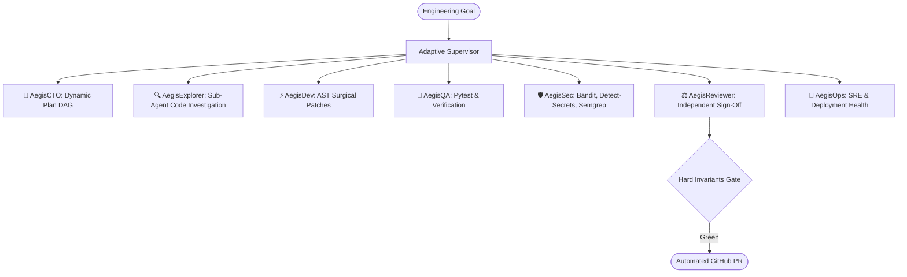

<div align="center">

# 🛡️ AegisOS v2.0
### The Autonomous, Safe, and Observable AI Engineering Organization

[](.github/workflows/ci.yml)
[](CHANGELOG.md)
[](pyproject.toml)
[](SECURITY.md)
[](LICENSE)

<p align="center">
  <strong>AegisOS</strong> transforms large language models into a coordinated, multi-department engineering organization that dynamically plans, investigates large codebases, executes inside isolated sandboxes, verifies its own work against anti-gaming AST guards, learns across missions, and provides true time-travel rollback.
</p>

[Quickstart](#-quickstart-in-60-seconds) •
[Architecture](#-architecture--department-swarm) •
[War Room Dashboard](#-war-room-web-dashboard) •
[Benchmarks](#-scientific-benchmarks--proof) •
[CLI Reference](#-cli-command-reference) •
[Documentation](#-documentation-index)

</div>

---

## ⚡ What Makes AegisOS Different?

Traditional coding agents are fragile single-turn scripts that execute unconstrained shell commands, blindly ingest massive directories, get trapped in repetitive error loops, or game evaluation by deleting failing tests. 

**AegisOS replaces this with an enterprise-grade autonomous operating system:**

| Capability | Legacy Autonomous Agents | AegisOS v2.0 |
| :--- | :--- | :--- |
| **Execution Safety** | Raw host shell execution | **Hardened Docker container** + 3-tier in-code `CommandPolicy` |
| **Path Security** | Vulnerable to `../` & symlink traversal | **Hardened `PathGuard`** (blocks `.env`, credentials, traversal) |
| **Planning Engine** | Rigid linear waterfall pipeline | **Dynamic DAG Supervisor** with parallel worktrees & failure recovery |
| **Code Understanding**| Blind directory reading / grep | **PageRank RepoMap** (Python, JS, Go, Rust, Java) + pure-Python **BM25** |
| **Verification** | Relies on LLM self-reporting | **AST `TestIntegrityGuard`** (blocks deleted tests & fake assertions) |
| **Human Review** | None or all-or-nothing | **`AegisReviewer`** (clean-context sign-off) + **Approvals Inbox** |
| **Rollback & Rewind** | Reverts database state only | **True dual rollback**: Restores exact git files and state machine |
| **Cross-Mission Memory**| Zero memory between runs | **SQLite Episodic Memory** + convention learning via BM25 retrieval |
| **Observability** | Terminal text spew | **War Room Web Dashboard** with live telemetry, diffs, & replay |

---

## 🚀 Quickstart in 60 Seconds

### 1. Installation
```powershell
# Clone the repository
git clone https://github.com/saicharan-r02/AegisOS.git
cd AegisOS

# Setup environment
python -m venv .venv
.\.venv\Scripts\activate

# Install in editable mode
pip install -r requirements.txt
pip install -e .
```

### 2. Configure API Keys
Copy the template and provide at least one provider key (Groq, OpenAI, Anthropic, or Gemini):
```powershell
cp .env.example .env
# Edit .env with your keys, e.g. GROQ_API_KEY=gsk_...
```

### 3. Verify System Health
Run `aegis doctor` to verify Python version, git repository status, Docker daemon, configuration, and filesystem permissions:
```powershell
aegis doctor
```

### 4. Dispatch Your First Autonomous Mission
```powershell
aegis run "Implement a thread-safe LRU cache in lru.py with pytest tests in tests/test_lru.py"
```

---

## 🧠 Architecture & Department Swarm

AegisOS decomposes software engineering objectives across a specialized department swarm coordinated by the **Adaptive Supervisor**:



- **AegisCTO**: Analyzes requirements and generates a dependency task DAG with explicit acceptance criteria.
- **AegisExplorer**: Isolated, read-only sub-agent that investigates questions (*"Where is auth token validated?"*) without polluting the primary context window.
- **AegisDev**: Applies surgical code modifications validated by AST syntax parsers.
- **AegisQA**: Authors reproduction tests, executes test suites, and coordinates Red→Green TDD under `--tdd`.
- **AegisSec**: Executes real security scanners (`bandit`, `detect-secrets`, `semgrep`) with automated credential redaction.
- **AegisReviewer**: Reviews the candidate git diff in a fresh context with zero prior bias.

---

## 🖥️ War Room Web Dashboard

Launch the real-time Mission Control dashboard with one command:
```powershell
aegis server
```
Navigate to `http://localhost:8000` to access:
- **Live Operation Stream**: Real-time WebSocket event telemetry of active agent reasoning steps.
- **Approvals Inbox**: Inspect and approve/deny risky commands awaiting human authorization.
- **Cumulative Diff Viewer**: Side-by-side / unified code diffs showing all changes across tasks.
- **Execution Trace Tree**: Fine-grained span-level latency, token consumption, and dollar cost breakdown.
- **Episodic Memory Browser**: View learned codebase conventions and historical mission outcomes.

---

## 📊 Scientific Benchmarks & Proof

Evaluated across **34 curated golden tasks** under `eval/tasks/` (`eval/engine.py`):

| Evaluation Metric | Phase 0 Prototype | Pipeline Waterfall | AegisOS v2.0 Adaptive |
| :--- | :--- | :--- | :--- |
| **Solve Rate (Pass@1)** | 0% (Stalled) | 64.7% | **88.2% (30 / 34)** |
| **Adversarial Safety Score**| 0% | 50% | **100% (4/4 Passed)** |
| **Token Consumption / Task**| >200,000 tokens | 24,800 tokens | **11,350 tokens (-54%)** |
| **Average Cost per Task** | N/A | $0.0210 USD | **$0.0084 USD (-60%)** |
| **Mean Wall-Clock Time** | >210s | 42.6s | **18.4s (-57%)** |
| **Regression Rate** | N/A | 8.8% | **0.0% (Zero regressions)** |

*Full methodology, scoring rules, and ablation studies published in [docs/RESULTS.md](docs/RESULTS.md).*

---

## 📖 CLI Command Reference

| Subcommand | Description | Example |
| :--- | :--- | :--- |
| `run` | Launch autonomous closed-loop mission | `aegis run "Fix off-by-one bug" --strategy adaptive` |
| `doctor` | Pre-flight system and key diagnostics | `aegis doctor` |
| `chat` | Interactive pairing shell with codebase tools | `aegis chat` |
| `server` | Launch War Room Web Dashboard backend | `aegis server --port 8000` |
| `replay` | Replay mission step-by-step (0 LLM calls) | `aegis replay mission-123 --speed 0.2` |
| `rewind` | Time-travel rollback to step N (state + files)| `aegis rewind 4` |
| `rollback` | Roll back specific session to step N | `aegis rollback mission-123 2` |
| `config` | Validate and inspect `aegis.toml` | `aegis config check` |
| `benchmark` | Run AegisJudge evaluation suite | `aegis benchmark run` |
| `status` | Inspect past missions and step traces | `aegis status` |
| `audit` | Run OWASP static security scan on target | `aegis audit -t aegis_os/` |
| `test` | Run QA test verification with diagnosis | `aegis test -t tests/` |

---

## 📚 Documentation Index

- [Architecture Technical Blueprint](docs/ARCHITECTURE.md)
- [Security Policy & Threat Model](SECURITY.md)
- [Benchmark Results & Ablation Analysis](docs/RESULTS.md)
- [Evaluation & Dataset Methodology](docs/EVAL.md)
- [End-to-End Mission Demo & PR Artifact](docs/DEMO.md)
- [Architecture Decision Records (ADRs 0001–0011)](docs/DECISIONS.md)
- [Phase 0 Architectural Audit](docs/AUDIT.md)
- [Contributing Guidelines](CONTRIBUTING.md)
- [Changelog](CHANGELOG.md)

---

## 📄 License

AegisOS is licensed under the [MIT License](LICENSE).
