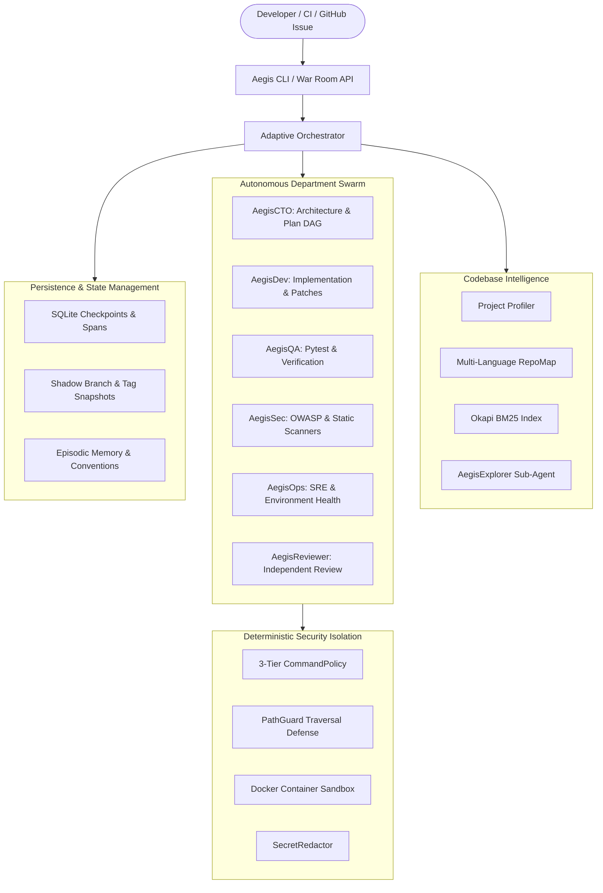
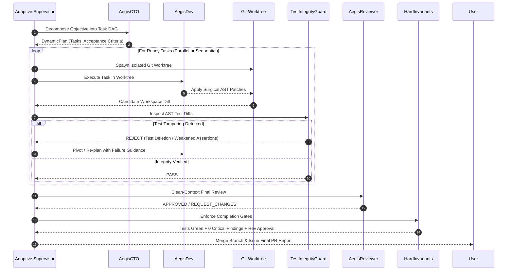
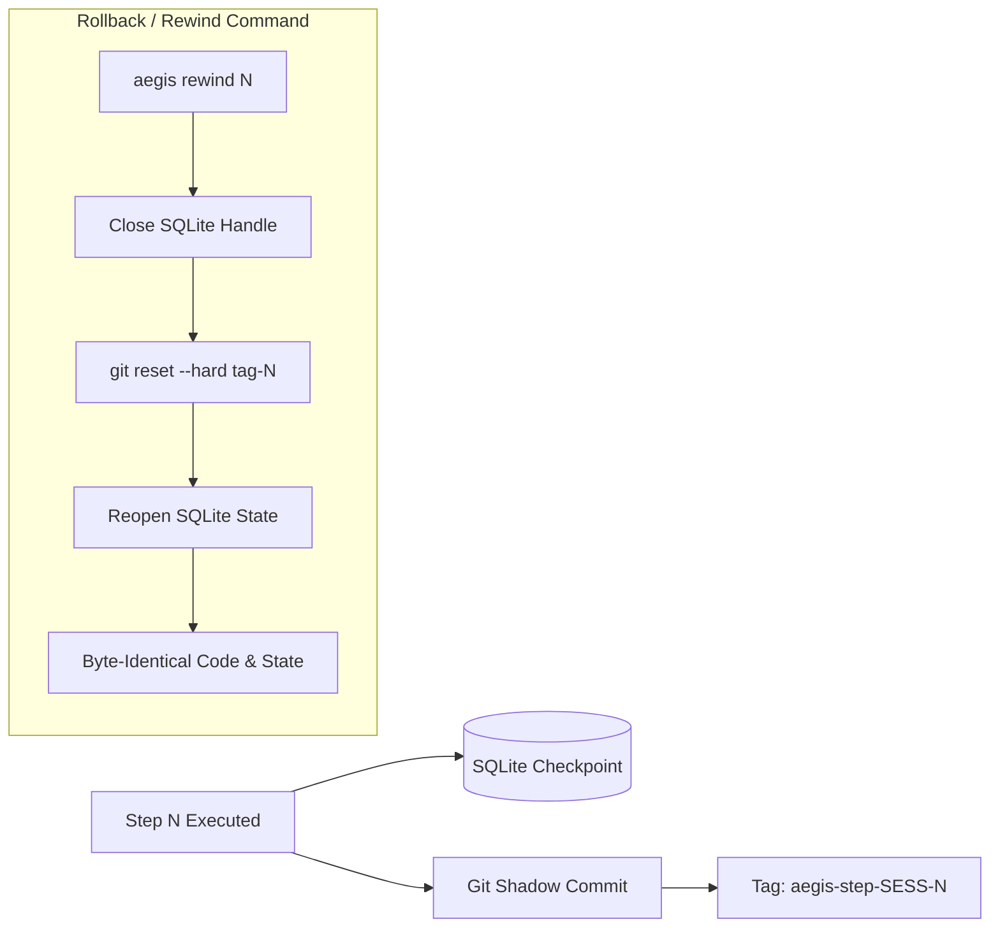

# AegisOS Architecture & Technical Blueprint (v2.0)

AegisOS is an enterprise-grade autonomous software-engineering organization coordinating specialized agent roles under deterministic safety policies, codebase intelligence, adaptive DAG planning, and anti-gaming verification.

---

## 1. High-Level System Architecture



---

## 2. Dynamic Adaptive Orchestration Loop

Unlike rigid waterfall pipelines (CTO → DEV → QA → SEC → OPS), the **Adaptive Supervisor (`--strategy adaptive`)** models missions as dependency DAGs, dynamically scheduling tasks and pivoting upon unexpected failures:



---

## 3. Time-Travel Debugging & Rollback Protocol

Every step captures dual point-in-time snapshots:



---

## 4. Role Responsibility Matrix & RBAC

| Role | Responsibility | Allowed Tools | RBAC Access |
| :--- | :--- | :--- | :--- |
| **CTO** | Goal decomposition, DAG creation, tech evaluation | `read_file`, `list_dir`, `get_repo_map`, `search_code` | Read-only |
| **DEV** | Code implementation, refactoring, patch generation | `read_file`, `write_file`, `replace_in_file`, `apply_patch` | Read/Write workspace |
| **QA** | Test generation, runner execution, regression triage | `pytest_runner`, `read_file`, `write_file` (scoped to `tests/`) | Test-scoped write |
| **SEC** | Static analysis (`bandit`, `detect-secrets`, `semgrep`) | `security_scanner`, `read_file`, `list_dir` | Read-only |
| **OPS** | Dependency audit, build checks, git hygiene | `git_status`, `git_diff`, `execute_command` (scoped) | Policy-bounded |
| **Reviewer** | Fresh context objective & diff validation | `read_file`, `git_diff`, `get_acceptance_criteria` | Read-only |
| **Explorer** | Sub-agent codebase inquiry without context pollution | `read_file`, `search_code`, `find_definition`, `get_repo_map` | Read-only |

---

## 5. Directory Layout & Module Structure

```text
AegisOS/
├── aegis_os/
│   ├── agents/          # Department agent archetypes (CTO, Dev, QA, Sec, Ops)
│   ├── cli/             # Rich terminal CLI, display formatting, doctor & chat
│   ├── config/          # Schema validator for aegis.toml
│   ├── intelligence/    # RepoMap, AST parser, PageRank, BM25 search & Explorer
│   ├── integrations/    # GitHub issues & automated PR generation
│   ├── kernel/          # State machine, checkpoint store, event bus & LLM router
│   ├── mcp/             # Model Context Protocol client & plugin engine
│   ├── memory/          # Multi-tier episodic memory & learned conventions
│   ├── orchestration/   # Dynamic DAG planner, worktree manager & adaptive loop
│   ├── sandbox/         # Docker container sandbox, subprocess fallback, policy
│   ├── security/        # SecretRedactor & static analysis scanners
│   ├── timetravel/      # ShadowBranchManager & TimeTravelController
│   ├── tools/           # Base tool contracts, AST tools, filesystem & VCS tools
│   ├── tracing/         # Structured span recording, JSONL export & replay engine
│   └── verification/    # BaselineVerifier, TestIntegrityGuard & AegisReviewer
├── docs/                # Architecture, baseline, results, ADRs & eval docs
├── eval/                # 34-task benchmark suite, golden datasets & judge engine
├── web/                 # Vite + React TypeScript War Room mission control dashboard
└── tests/               # Unit, property, and end-to-end integration test suites
```
